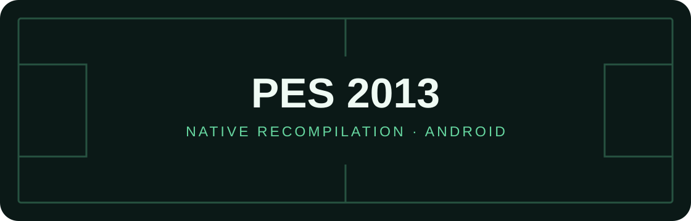

<p align="center"></p>

<h1 align="center">PSPRecomp · PES 2013 Android</h1>

<p align="center">
  
  
  
  
</p>

Recompilación estática experimental de **Pro Evolution Soccer 2013 para PSP**
hacia código nativo, con Android ARM64 como plataforma objetivo.

> **Todavía no es jugable.** El arranque traducido ya se ejecutó en PC y en un
> Samsung Galaxy S25 Ultra. Seguimos trabajando en los servicios de PSP y los
> módulos de código que el juego carga durante la ejecución. Existe una app de
> desarrollo local para pruebas; no hay APK publicado ni releases.

## Avance comprobado

| Componente | Estado |
| --- | --- |
| Copia analizada | PSP USA, `ULUS10597` |
| EBOOT traducido | 161 unidades C++; análisis de tablas de saltos corregido |
| Compilación nativa | Windows x64 y Android ARM64 |
| Prueba en S25 Ultra | Ejecuta `bootset` y `memorycard`; app de desarrollo instalada |
| Módulos `.ovl` | 69 extraídos; 28 con código, 41 con texto vacío |
| Traducción experimental de overlays | 576 unidades C++; 604 archivos comprobados para ARM64 |
| Servicios de arranque | UMD, mutex ligeros, alarmas, SAS y lectura de archivos CPK |
| Menú y partidos | Pendientes |
| Vulkan, audio y controles | Base de app conectada; validación en juego pendiente |

Los detalles técnicos y los límites de cada prueba están en el
[perfil de PES](profiles/pes2013/README.md).
El [avance comprobado](docs/PROGRESS.md) identifica el bloqueo actual y los
siguientes pasos.

## Por qué requiere un perfil propio

PES carga módulos distintos para el título, la selección de equipos, los
partidos y otros modos. Algunos ocupan las mismas direcciones de memoria en
momentos distintos. El port debe seleccionar el código traducido que corresponde
al módulo activo, además de implementar los servicios PSP que necesita el juego.

Este trabajo parte del framework [PSPRecomp](https://github.com/jessicanataliagta/PSPRecomp)
y de la infraestructura desarrollada en
[VCS Android](https://github.com/codepdbh/PSPRecomp-VCS-Android) y
[LCS Android](https://github.com/codepdbh/PSPRecomp-LCS-Android).
Los archivos conservados bajo `profiles/vcs` sirven como base del host compartido
y del generador; los parches de direcciones de GTA no se deben aplicar a PES.

## Empezar desde el código fuente

Necesitas CMake, un compilador C++20 y Python 3. Para ARM64, utiliza Android NDK
`28.2.13676358`. Para preparar el juego, aporta tu propia copia PSP `ULUS10597`
y su EBOOT descifrado.

### 1. Compilar las herramientas en Windows

```powershell
cmake -S . -B out/pes2013-probe -DPSPRECOMP_PROFILE=pes2013 -DPSPRECOMP_BUILD_TESTS=OFF -DPSPRECOMP_GENERATED_OPT_LEVEL=0 -DPSPRECOMP_MSVC_MP_JOBS=4
cmake --build out/pes2013-probe --config Release --target psp_analyze pes2013_recomp --parallel 1
```

Un checkout limpio puede compilar las herramientas sin datos comerciales.

### 2. Preparar tu copia

```powershell
./profiles/pes2013/tools/prepare.ps1 -Iso "C:/mis-juegos/pes2013.iso" -DecryptedElf "C:/mis-juegos/ULUS10597_EBOOT.BIN"
```

El script verifica la identidad del disco y el hash del ejecutable, extrae los
overlays, genera la auditoría de servicios y produce el corpus C++ local.

### 3. Compilar la prueba de arranque

```powershell
cmake -S . -B out/pes2013-probe -DPSPRECOMP_PROFILE=pes2013
cmake --build out/pes2013-probe --config Release --target pes2013_probe --parallel 1
./out/pes2013-probe/profiles/pes2013/Release/pes2013_probe.exe profiles/pes2013/game
```

La prueba informa del punto de detención. El código de salida `3` señala un
resultado diagnóstico; no significa que el juego sea jugable.
Las instrucciones de compilación ARM64 están en el [perfil](profiles/pes2013/README.md).

## Próximos hitos

- [x] Identificar la ISO y obtener el ELF local.
- [x] Traducir y compilar el EBOOT para PC y Android ARM64.
- [x] Ejecutar la prueba inicial en el S25 Ultra.
- [x] Extraer los 69 overlays de `OVER.cpk`.
- [x] Traducir los 28 overlays con código a espacios de nombres separados.
- [x] Comprobar la sintaxis ARM64 de esos archivos C++.
- [ ] Integrar los servicios de arranque de PSP.
- [x] Verificar la carga y ejecutar el primer overlay traducido.
- [ ] Llegar al menú y a un partido.
- [ ] Integrar y validar Vulkan, audio y controles en una app independiente.

El banco AOT selecciona el módulo presente en RAM y comprueba su cabecera y código.
Hay cinco módulos de arranque enlazados; aún faltan módulos y servicios para jugar.
Los avances de compilación no equivalen a que el menú o un partido funcionen.

## Datos y licencias

El repositorio contiene herramientas y código fuente. La ISO, el EBOOT, los
overlays extraídos y los datos de PES se preparan localmente y están ignorados
por Git, al igual que el corpus experimental generado.

Framework bajo [MIT](LICENSE). Consulta los
[avisos de terceros](profiles/vcs/THIRD_PARTY.md) para los componentes heredados.
Proyecto comunitario no oficial, sin afiliación con Konami, Sony ni CRI Middleware.
